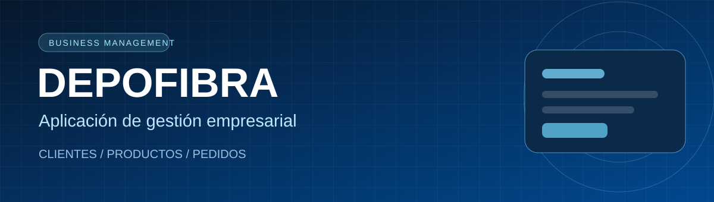

<div align="center">
  

  <br/>

  
  
  
  

  <br/><br/>

  **Aplicación multiplataforma para centralizar la gestión de clientes, productos y pedidos de Depofibra.**

  [Web corporativa actual](https://depofibra.com/) · [Repositorio de la web](https://github.com/juanjogamero/website-depofibra)

</div>

---

## El proyecto

**Depofibra Gestión Integral** es una aplicación de gestión empresarial construida con **Flutter y Dart** y conectada a **Firebase Authentication y Cloud Firestore**. Su finalidad es reunir en una única interfaz tres áreas habituales de una empresa comercial: clientes, catálogo de productos y seguimiento básico de pedidos.

Este repositorio contiene la **aplicación de gestión**, no el código fuente de la web pública de Depofibra. Se presenta como proyecto de desarrollo de software; no se declara como sistema listo para producción.

## Funcionalidades implementadas

<table>
<tr>
<td width="33%" valign="top">
<h3>01 / Clientes</h3>
Registro, consulta, edición y eliminación de clientes. Almacena nombre, correo electrónico y teléfono.
</td>
<td width="33%" valign="top">
<h3>02 / Productos</h3>
Gestión de artículos con nombre, categoría, capacidad en litros y precio.
</td>
<td width="34%" valign="top">
<h3>03 / Pedidos</h3>
Pedidos vinculados a un cliente y a un producto, con fecha y estados Pendiente, En Proceso y Entregado.
</td>
</tr>
</table>

**Acceso:** inicio de sesión con Google mediante Firebase Authentication y cambio automático entre la pantalla de login y la pantalla principal en función de la sesión.

**Datos:** lectura en tiempo real y operaciones CRUD mediante Cloud Firestore.

> [!NOTE]
> El proyecto implementa la estructura básica de gestión. No consta en el repositorio un sistema completo de roles, contabilidad, facturación o control granular de permisos. Esas capacidades no deben darse por implementadas.

## Tecnologías

| Capa | Tecnología | Uso |
| :-- | :-- | :-- |
| Interfaz | Flutter · Dart · Material 3 | Pantallas y componentes visuales |
| Autenticación | Firebase Auth · Google Sign-In | Inicio y cierre de sesión |
| Base de datos | Cloud Firestore | Colecciones y suscripciones a cambios |
| Formato | intl | Presentación de fechas |
| Calidad | flutter_test · flutter_lints | Pruebas de modelos y análisis estático |

## Arquitectura

```text
lib/
├── main.dart                 # Inicialización de Firebase y navegación por sesión
├── models/
│   ├── cliente.dart          # Entidad de cliente
│   ├── producto.dart         # Entidad de producto
│   └── pedido.dart           # Entidad de pedido
├── screens/
│   ├── login_screen.dart     # Autenticación
│   ├── home_screen.dart      # Navegación de gestión
│   ├── clientes_screen.dart  # CRUD de clientes
│   ├── productos_screen.dart # CRUD de productos
│   └── pedidos_screen.dart   # CRUD y estados de pedidos
├── services/
│   ├── auth_service.dart     # Firebase Auth / Google
│   └── firestore_service.dart# Acceso a Firestore
└── widgets/
    └── input_decorations.dart

test/
└── widget_test.dart          # Pruebas de serialización de modelos
```

### Flujo de la aplicación

```text
Inicio → Firebase.initializeApp()
          ↓
  Estado de autenticación
     ├── Sin sesión → Login con Google
     └── Con sesión → Panel principal
                        ├── Clientes
                        ├── Productos
                        └── Pedidos
                              ↓
                        Cloud Firestore
```

Las entidades se transforman a mapas mediante `toMap()` y se reconstruyen mediante `fromMap()`. Los pedidos guardan referencias por ID a cliente y producto, además de la fecha y el estado.

## Ejecutar en desarrollo

### Requisitos

- Flutter SDK compatible con el SDK Dart indicado en `pubspec.yaml` (`^3.10.7`).
- Un proyecto Firebase propio con Authentication y Cloud Firestore habilitados.
- Configuración específica de Firebase para la plataforma de ejecución.
- Proveedor de acceso con Google configurado para las plataformas donde se pruebe.

```bash
git clone https://github.com/juanjogamero/depofibra.git
cd depofibra
flutter pub get
flutter analyze
flutter test
flutter run
```

> [!IMPORTANT]
> **Firebase requiere configuración previa.** El `main.dart` actual utiliza `Firebase.initializeApp()` sin opciones explícitas. Para ejecutar la aplicación debes aportar los archivos/configuración de Firebase adecuados a tu plataforma, registrar las aplicaciones necesarias y configurar Google Sign-In. El repositorio, tal como está, no garantiza un arranque inmediato en todas las plataformas.

## Calidad y consideraciones antes de producción

El repositorio incluye pruebas básicas de serialización de `Cliente` y `Producto`, que sustituyen al test por defecto del contador de Flutter. No se afirma que haya sido ejecutada una compilación o un análisis de Flutter en CI.

Antes de utilizar datos empresariales reales, conviene:

1. Configurar y probar **Firebase Security Rules** para limitar acceso y escrituras por usuario autorizado.
2. Añadir **roles y permisos** y políticas de acceso a datos de clientes.
3. Revisar validaciones, errores de red, confirmaciones de borrado y estados de carga.
4. Implementar pruebas de interfaz e integración, además de un pipeline de CI.
5. Comprobar dependencias, configuración multiplataforma y documentación de despliegue.

**Privacidad:** evita almacenar datos personales reales en proyectos Firebase de prueba. La autenticación por sí sola no sustituye a las reglas de autorización de Firestore.

## Estado del proyecto

**Prototipo funcional en código / desarrollo.** Se incluyen navegación, CRUD, autenticación y servicios de datos; las integraciones deben configurarse y verificarse en un entorno de Firebase antes de considerar la aplicación operativa. No hay enlace de demostración público confirmado para este repositorio.

---

<div align="center">
  <strong>Desarrollado por <a href="https://github.com/juanjogamero">Juan José Gamero López</a></strong><br/>
  <sub>Flutter · Firebase · Aplicaciones a medida para negocio</sub>
</div>
